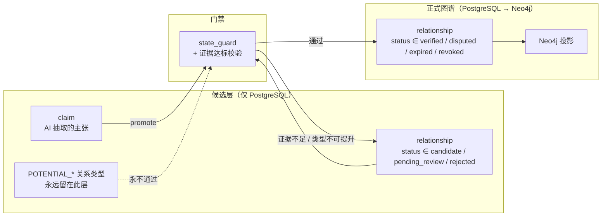

# API 契约规范（FIG API Contracts）

> 版本 **v1.0** · 2026-11-13 · 状态：**frozen**
> 冻结依据：架构决策 2026-11-13（双层结构 + PG 为状态机唯一真源）
> 维护者：`architect` ｜ 消费方：`frontend`、`industry-ai`、`graph-eng`、`devops`
> 冻结后任何变更必须走 `docs/adr/` + `changelog.md` + 版本号递增。

---

## 一、总则

| 项 | 规定 |
|---|---|
| Base path | `/api/v1`（仅业务端点） |
| 探针 | `/health`、`/ready` **不带版本前缀**，不属于业务契约 |
| 协议 | HTTPS（生产）/ HTTP（本地） |
| 编码 | UTF-8，`Content-Type: application/json` |
| 时间 | ISO 8601 UTC，带 `Z`，如 `2026-11-13T00:20:00Z`。禁止本地时区字符串 |
| 金额 | 字符串十进制（`"1234567.89"`），禁止 float |
| ID | UUIDv7 字符串（时间有序），应用侧生成 |
| 字段命名 | `snake_case` |
| 未知字段 | 服务端忽略未知请求字段；客户端必须容忍未知响应字段 |
| 版本策略 | `/v1` 内只做加法。破坏性变更 → `/v2` |
| 鉴权 | P1–P3 单用户本地部署无鉴权；P4 起 `Authorization: Bearer` |

---

## 二、双层结构（核心契约）

本项目的关系数据分两层，**跨层的唯一通道是状态迁移**：



**三条硬承诺（契约级，不是实现细节）**：

1. `candidate` / `pending_review` / `rejected` 状态的关系**永不出现在任何 `/graph/*` 响应中**。
2. `POTENTIAL_*` 四类关系（`potential_beneficiary` / `potential_loser` / `potential_supplier` / `potential_customer`）**永不进入 Neo4j**，只能在候选层端点读到。
3. 前端展示「未验证」信息时，数据源是 `/claims` 与 `/relationships?status=candidate`，**不是**图谱端点。

---

## 三、统一响应信封

### 3.1 成功

```json
{
  "data": {},
  "meta": {
    "request_id": "01JCH3X8QK7YV2N5M9P0R4T6WA",
    "generated_at": "2026-11-13T00:20:00Z"
  }
}
```

- `meta` 必带 `request_id` 与 `generated_at`。
- 列表端点必带 `next_cursor`；图谱端点必带 `truncated` 与 `node_limit`。
- 顶层不出现业务字段。

### 3.2 失败

```json
{
  "error": {
    "code": "EVIDENCE_REQUIRED",
    "message": "关系缺少达标证据，无法置为 verified",
    "details": {
      "relationship_id": "0192...",
      "reasons": ["weak evidence: best=C, distinct_C=1, need 1x A/B or 2x C"],
      "required": "1x A/B or 2 distinct C"
    },
    "request_id": "01JCH3X8QK7YV2N5M9P0R4T6WA"
  }
}
```

- **404 / 405 也走信封**（已实现 `StarletteHTTPException` 处理器）。
- 不返回堆栈、不返回内部路径、不返回 SQL。

### 3.3 错误码表（封闭集合）

| HTTP | code | 含义 |
|---|---|---|
| 400 | `VALIDATION_ERROR` | 请求体/参数不合法 |
| 400 | `DEPTH_LIMIT_EXCEEDED` | 深度超上限（>5） |
| 400 | `NODE_LIMIT_EXCEEDED` | 节点数超上限 |
| 401 | `UNAUTHORIZED` | 未认证 |
| 403 | `FORBIDDEN` | 无权限 |
| 404 | `NOT_FOUND` | 资源不存在（含未知路由） |
| 409 | `CONFLICT` | 唯一约束冲突 |
| 409 | `STATE_TRANSITION_INVALID` | 非法状态迁移 / 该关系类型不可入图 |
| 422 | `EVIDENCE_REQUIRED` | 证据不足或无 Claim 支撑 |
| 422 | `CLAIM_TYPE_NOT_PROMOTABLE` | 该 Claim 类型不可提升 |
| 429 | `RATE_LIMITED` | 触发限流 |
| 502 | `UPSTREAM_UNAVAILABLE` | 外部依赖不可用 |
| 503 | `DEPENDENCY_NOT_READY` | PG / Neo4j / 迁移版本未就绪 |
| 500 | `INTERNAL_ERROR` | 未分类错误 |

### 3.4 分页与截断

| 端点类型 | 策略 |
|---|---|
| 列表（`/news`、`/entities`、`/claims`、`/quality/issues`） | **游标分页**。`limit` 默认 50、最大 200；`meta.next_cursor` 为 `null` 表示结束；排序固定 `created_at DESC, id DESC` |
| 图谱（`/graph/*`） | **不分页**。一次返回整块子图，`meta.truncated=true` 即**终态**——客户端要更多数据必须缩小范围重新请求，不存在续页游标 |

> 图谱不分页的理由：图的一次渲染需要闭合的邻域，分页会得到断裂的边。用 `depth` / `node_limit` / `min_confidence` 控制规模，比翻页更符合使用方式。

---

## 四、枚举（唯一真源：`backend/app/schemas/enums.py`）

### 4.1 关系状态（7 态）

```python
class RelationshipStatus(StrEnum):
    CANDIDATE      = "candidate"       # 候选，AI 产出或人工录入
    PENDING_REVIEW = "pending_review"  # 待核验，已进核验队列
    VERIFIED       = "verified"        # 已验证，进入图谱
    DISPUTED       = "disputed"        # 存在冲突证据，双方证据都保留
    REJECTED       = "rejected"        # 已否定（终态）
    EXPIRED        = "expired"         # 已过期
    REVOKED        = "revoked"         # 已撤销（终态，行不删除）
```

> `DISPUTED` 是决策清单之外新增的第 7 态。理由：总任务书第八节要求「存在冲突时必须保留双方证据，不允许 AI 自行选一个版本」。没有这个状态，冲突证据无处安放。**此条已列入评审报告待裁决项。**

### 4.2 合法迁移表（唯一真源，代码见 `validation/state_guard.py`）

| from \ to | candidate | pending_review | verified | disputed | rejected | expired | revoked |
|---|---|---|---|---|---|---|---|
| **candidate** | — | ✅ | ❌ | ❌ | ✅ | ❌ | ✅ |
| **pending_review** | ❌ | — | ✅ | ✅ | ✅ | ❌ | ✅ |
| **verified** | ❌ | ❌ | — | ✅ | ❌ | ✅ | ✅ |
| **disputed** | ❌ | ❌ | ✅ | — | ✅ | ❌ | ✅ |
| **expired** | ❌ | ✅ | ✅ | ❌ | ❌ | — | ✅ |
| **rejected** | ❌ | ❌ | ❌ | ❌ | — | ❌ | ❌ |
| **revoked** | ❌ | ❌ | ❌ | ❌ | ❌ | ❌ | — |

- `verified → candidate` **禁止**。这是反幻觉的核心：已验证事实不能被静默降级。
- `verified → rejected` **禁止**。否定必须先经 `disputed`，否则证据轨迹被抹掉。
- `rejected` / `revoked` 是终态，无出边。

### 4.3 其他枚举

| 枚举 | 取值 |
|---|---|
| `ClaimType` | `fact_reported` / `inferred` / `hypothesis` / `disputed` |
| `EvidenceGrade` | `A` / `B` / `C` / `D` |
| `NewsEventType` | `policy` `regulation` `earnings` `guidance` `capex` `order` `contract` `capacity` `technology` `product_launch` `m_and_a` `supply_disruption` `price_change` `macro` `geopolitics` `other` |
| `ImpactDirection` | `positive` / `negative` / `uncertain` |
| `ImpactPathStatus` | `valid` / `invalidated` / `stale` |
| `RelationshipType` | 见 `enums.py`，其中 `potential_*` 四类为候选层专用 |

**`EntityType` 已移除 `customer` / `supplier` / `competitor`**：它们是关系角色，不是实体种类，留在枚举里会诱导把「客户」建成实体。

### 4.4 置信度上限（代码与 DB 双重约束）

| claim_type | 上限 |
|---|---|
| `fact_reported` | 1.0 |
| `inferred` | 0.6 |
| `hypothesis` | 0.3 |

---

## 五、提升为 verified 的三个前置条件（全部满足）

1. 关系至少关联 **1 条 Claim**（无 Claim = 无来源，直接 422）。
2. 所有关联 Claim 的 `claim_type` 必须为 `fact_reported`（任一为 `inferred`/`hypothesis` → 422 `CLAIM_TYPE_NOT_PROMOTABLE`）。
3. 证据达标：**≥1 条 A/B 级**，或 **≥2 条不同 `content_hash` 的 C 级**。同一文章的多家转载按 1 条计（`content_hash` 去重）。
4. 若存在 `contradicting` 证据 → 只能进 `disputed`，不得进 `verified`。

---

## 六、端点清单

### 6.1 系统（不带版本前缀）

| 方法 | 路径 | 说明 | 阶段 |
|---|---|---|---|
| GET | `/health` | 存活探针，不查依赖 | ✅ 已实现 |
| GET | `/ready` | 就绪探针：PG + Neo4j + Alembic 版本，5s TTL 缓存，任一失败 503 | ✅ 已实现 |
| GET | `/openapi.json` | OpenAPI 3.1 | ✅ 已实现 |

`/ready` 响应：

```json
{
  "data": {
    "status": "ready",
    "version": "0.1.0",
    "checks": {
      "postgres":  { "ok": true, "error": null },
      "neo4j":     { "ok": true, "error": null },
      "migration": { "ok": true, "current": "bdaf9a0511cb", "expected": "bdaf9a0511cb", "error": null }
    }
  },
  "meta": { "request_id": "...", "generated_at": "...", "cached": false }
}
```

### 6.2 采集

| 方法 | 路径 | 说明 | 阶段 |
|---|---|---|---|
| POST | `/ingest/run` | 触发采集。**异步**：立即返回 202 + `run_id`，需 `Idempotency-Key` 头 | P2 |
| GET | `/ingest/runs/{run_id}` | 运行统计（含 per-source 明细） | P2 |
| GET | `/ingest/sources` | 信源清单 + `last_fetched_at` 水位 + 最近状态 | P2 |
| GET | `/ingest/dead-letters` | 失败条目（可按 `error_type`、`retryable` 过滤） | P2 |
| POST | `/ingest/dead-letters/{id}/retry` | 重放一条失败记录 | P2 |

`POST /ingest/run` 请求/响应：

```json
// request
{ "source_keys": ["sse_announcement"], "since": "2026-11-12T00:00:00Z" }

// 202 Accepted
{ "data": { "run_id": "0192...", "status": "running" }, "meta": { } }
```

### 6.3 新闻

| 方法 | 路径 | 说明 |
|---|---|---|
| GET | `/news` | `since, until, source_key, event_type, q`，游标分页 |
| GET | `/news/{id}` | 详情 + 原文快照 + 已抽出的 Claim 摘要 |

### 6.4 实体与产业

| 方法 | 路径 | 说明 |
|---|---|---|
| GET | `/industries` | **产业树**（含层级、`entity_count`），供左栏筛选 |
| GET | `/entities` | `entity_type, q, industry_code`，游标分页 |
| GET | `/entities/{id}` | 实体详情（含 aliases、stock_code） |
| GET | `/entities/{id}/relations` | 该实体的关系（默认只返回 verified，见 `status` 参数） |
| GET | `/companies` | `industry_code, q` |
| GET | `/companies/{stock_code}` | 按代码查公司 |

### 6.5 证据

| 方法 | 路径 | 说明 |
|---|---|---|
| POST | `/evidence` | **写入证据**（Agent 落地 `evidence_refs` 的唯一入口）。`original_excerpt` 必填，`content_hash` 由服务端按正文计算 |
| GET | `/evidence/{id}` | 单条证据 |
| GET | `/relationships/{id}/evidence` | 该关系的全部证据（含等级、来源、摘录、发布时间） |

`Evidence` 对象（前后端共用，字段固定）：

```json
{
  "id": "0192...",
  "source_type": "announcement",
  "source_name": "巨潮资讯",
  "source_url": "https://...",
  "title": "关于签订重大合同的公告",
  "original_excerpt": "公司与XX签订高速光模块供货合同，金额 3.2 亿元。",
  "published_at": "2026-11-10T00:00:00Z",
  "collected_at": "2026-11-12T03:00:00Z",
  "evidence_grade": "A",
  "verification_status": "unverified",
  "content_hash": "sha256:...",
  "repost_count": 1
}
```

### 6.6 图谱（只读，只含已验证层）

| 方法 | 路径 | 说明 |
|---|---|---|
| GET | `/graph/subgraph` | 首屏子图。`industry_code, entity_types[], status, min_confidence, node_limit≤2000` |
| GET | `/graph/neighbors` | `node_id, direction=up\|down\|both, depth≤5, relation_types[], min_confidence` |
| POST | `/graph/expand` | 受限扩展，返回 `expansion_id` |
| GET | `/graph/path` | `from, to, max_depth≤5` |

`/graph/subgraph` 与 `/graph/neighbors` 共用同一响应结构：

```json
{
  "data": {
    "center": "0192a1b2-...",
    "nodes": [
      { "id": "0192a1b2-...", "entity_type": "listed_company", "name": "示例科技",
        "stock_code": "300001", "industry_code": "AI-COMPUTE-OPTICAL" }
    ],
    "edges": [
      {
        "relationship_id": "0192c3d4-...",
        "source": "0192a1b2-...",
        "target": "0192e5f6-...",
        "relationship_type": "supplies_to",
        "status": "verified",
        "confidence": 0.82,
        "valid_from": "2024-03-01T00:00:00Z",
        "valid_to": null,
        "evidence_count": 3,
        "evidence_grade_max": "A",
        "evidence_missing": false
      }
    ]
  },
  "meta": {
    "request_id": "01J...",
    "generated_at": "2026-11-13T00:20:00Z",
    "truncated": true,
    "node_limit": 300,
    "depth_used": 2
  }
}
```

**`status` 只作用于边，不作用于节点**。节点没有状态——只有实体是否存在。`include_disputed=true` 才返回 disputed 边；`revoked` 边仅 admin 可见。

**`as_of` 参数在 v1 中不存在。** 时态查询（某时间点的图）推迟到 P4 评估，理由见 `docs/adr/`。不要再在客户端传这个参数。

### 6.7 关系（状态迁移）

| 方法 | 路径 | 说明 |
|---|---|---|
| GET | `/relationships` | `status, relationship_type, entity_id`。**候选层读取入口**：`?status=candidate` 用于前端展示「未验证」 |
| GET | `/relationships/{id}` | 详情 + 证据 + 历史摘要 |
| GET | `/history/relationships/{id}` | 历史版本全量 |
| POST | `/relationships/{id}/submit-review` | `candidate → pending_review` |
| POST | `/relationships/{id}/verify` | `pending_review → verified`，需 `actor, reason` |
| POST | `/relationships/{id}/dispute` | `→ disputed`，需 `actor, reason, evidence_ids[]` |
| POST | `/relationships/{id}/reject` | `→ rejected`，需 `actor, reason` |
| POST | `/relationships/{id}/revoke` | `→ revoked`，需 `actor, reason`（**不删除**） |

> **没有 `POST /relationships`，也没有 `DELETE`。** 关系只能由 Claim 提升产生，只能状态迁移消亡。

### 6.8 Claim（候选层）

| 方法 | 路径 | 说明 |
|---|---|---|
| POST | `/analyze/news/{id}` | 触发分析，幂等（同 `news_id` 返回同一 `analysis_id`） |
| GET | `/analyze/{analysis_id}` | 结果（claims / unknowns / needs_human_review / token 成本） |
| GET | `/claims` | `status, claim_type, subject_entity_id`，游标分页 |
| POST | `/claims/{id}/promote` | 提升为关系。走 `state_guard`；`inferred`/`hypothesis` → 422 |
| POST | `/claims/{id}/reject` | 否定 Claim |

### 6.9 事件与传导

| 方法 | 路径 | 说明 |
|---|---|---|
| GET | `/events` | `since, until, event_type, importance` |
| GET | `/events/{id}` | 详情 + 关联实体 |
| POST | `/events/{id}/propagate` | `depth≤5, max_nodes, min_evidence_grade` |
| GET | `/events/{id}/impact-paths` | 路径列表（含 `status`） |

### 6.10 质量中心

| 方法 | 路径 | 说明 |
|---|---|---|
| GET | `/quality/metrics` | 七项指标 + 时间序列 |
| GET | `/quality/issues` | `issue_type, severity, status` |
| POST | `/quality/scan` | `scope=full\|incremental` |
| POST | `/quality/issues/{id}/resolve` | `{resolution_note}` |
| GET | `/quality/impact/{relationship_id}` | 该关系被撤销后的下游影响清单 |

### 6.11 系统管理

| 方法 | 路径 | 说明 |
|---|---|---|
| GET | `/admin/agents` | Agent 清单与最近运行状态 |
| GET | `/admin/tasks` | 调度任务与执行历史 |
| GET | `/admin/logs` | `level, since, limit` |
| GET/PATCH | `/admin/settings` | 扩展深度、节点上限、置信阈值 |

---

## 七、幂等

| 场景 | 机制 |
|---|---|
| `POST /ingest/run` | 必带 `Idempotency-Key`；同 key 24h 内返回首次结果（落库表 `idempotency_key`） |
| `POST /analyze/news/{id}` | 以 `news_id` 为键天然幂等 |
| 状态迁移端点 | 目标状态 == 当前状态 → 200 + 当前状态，不报错（已实现） |
| 客户端重试 | 仅对 `429 / 502 / 503` 与网络错误重试；指数退避，最多 3 次 |

---

## 八、契约冻结与变更流程

```
提案（docs/adr/ADR-xxxx.md）
 → architect 评估（兼容性 / 影响端点 / 影响 Agent）
 → 更新本文件 + changelog.md + 版本号
 → 更新 backend/app/schemas/ + OpenAPI
 → frontend 重新生成类型
 → 契约测试通过
```

**破坏性变更**：删字段、改类型、改枚举含义、改状态机、改错误码语义。

---

## 九、本版已关闭的待评审项

| # | 原问题 | 结论 |
|---|---|---|
| 1 | ID 用 UUIDv7 还是 ULID | **UUIDv7**，已实现（`core/ids.py`） |
| 2 | 图谱 `as_of` 时态何时做 | **v1 不做**，P4 评估；参数已移除 |
| 3 | 审批人模型单用户 vs 角色表 | P3 前单用户，`actor` 为自由字符串（`agent:qa-audit` / `human:kevin`） |
| 4 | 采集触发是否暴露前端 | 仅 admin，P2 开放 |
| 5 | 图谱端点是否分页 | **不分页**，`truncated` 即终态 |
