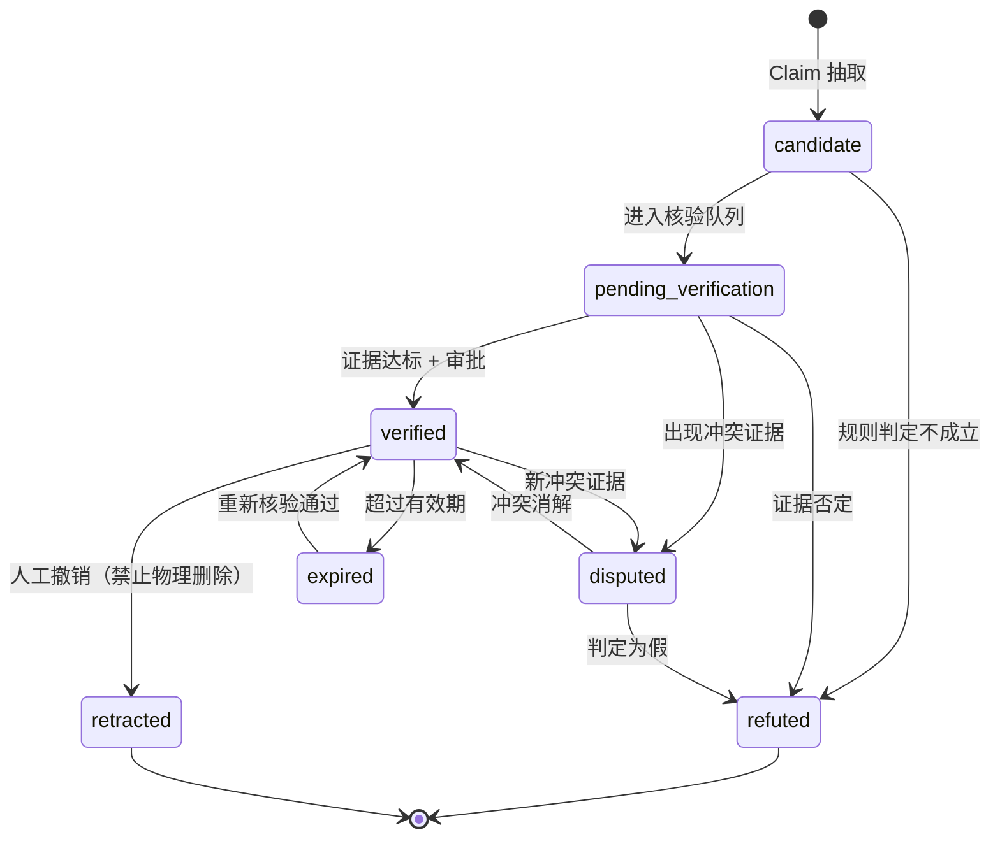

# API 契约规范（FIG API Contracts）

> 版本 **v0.1** · 2026-11-12 · 状态：**draft（待冻结）**
> 冻结后（`status: frozen`）任何变更必须走 ADR + `changelog.md`。
> 维护者：`architect` ｜ 消费方：`frontend`、`industry-ai`、`graph-eng`、`devops`

---

## 一、总则

| 项 | 规定 |
|---|---|
| Base path | `/api/v1` |
| 协议 | HTTPS（生产）/ HTTP（本地） |
| 编码 | UTF-8，`Content-Type: application/json` |
| 时间 | ISO 8601 UTC，带 `Z`，如 `2026-11-12T14:03:00Z`。**禁止本地时区字符串** |
| 金额 | 字符串十进制（`"1234567.89"`），禁止 float |
| ID | UUIDv7 字符串（时间有序，便于分页与排查）。对外一律字符串 |
| 字段命名 | `snake_case`（与 Python 一致；前端由 OpenAPI 生成类型） |
| 未知字段 | 服务端**忽略**未知请求字段；客户端**必须容忍**未知响应字段（前向兼容） |
| 版本策略 | `/v1` 内只做加法（新增字段/端点）。破坏性变更 → `/v2`，`/v1` 至少保留一个 Phase |
| 鉴权 | P0–P3 单用户本地部署，暂不做鉴权；P4 起引入 `Authorization: Bearer <token>`。**预留中间件位置，不预留占位响应头** |

---

## 二、统一响应信封

### 2.1 成功

```json
{
  "data": { },
  "meta": {
    "request_id": "01JCH3X8QK7YV2N5M9P0R4T6WA",
    "generated_at": "2026-11-12T14:03:00Z",
    "next_cursor": null,
    "truncated": false
  }
}
```

- `data`：资源对象或数组。列表端点 `data` 为数组。
- `meta`：**必带** `request_id` 与 `generated_at`；列表端点必带 `next_cursor`；图谱类端点必带 `truncated`。
- 顶层**不出现**业务字段，一律放 `data` 内。

### 2.2 失败

```json
{
  "error": {
    "code": "EVIDENCE_REQUIRED",
    "message": "关系 R-xxx 缺少达标证据，无法置为 verified",
    "details": {
      "relationship_id": "0192...",
      "required_grade": "C",
      "found_grades": ["D"],
      "rule_id": "EVD-003"
    },
    "request_id": "01JCH3X8QK7YV2N5M9P0R4T6WA"
  }
}
```

- **不返回堆栈**、不返回内部路径、不返回 SQL。
- `details` 用于前端可编程处理，结构由各端点定义。
- 失败时 HTTP 状态码必须与 `code` 匹配（见下表）。

### 2.3 错误码表（**封闭集合，新增需改本文件**）

| HTTP | code | 含义 | 典型场景 |
|---|---|---|---|
| 400 | `VALIDATION_ERROR` | 请求体/参数不合法 | 枚举值非法、缺必填 |
| 400 | `DEPTH_LIMIT_EXCEEDED` | 深度超上限 | `depth=6`（上限 5） |
| 400 | `NODE_LIMIT_EXCEEDED` | 节点数超上限 | 扩展请求过大 |
| 401 | `UNAUTHORIZED` | 未认证 | P4 起 |
| 403 | `FORBIDDEN` | 无权限 | 非审批人调用审批端点 |
| 404 | `NOT_FOUND` | 资源不存在 | 无效 UUID |
| 409 | `CONFLICT` | 唯一约束冲突 | 重复股票代码 |
| 409 | `STATE_TRANSITION_INVALID` | 非法状态迁移 | `verified → candidate` |
| 422 | `EVIDENCE_REQUIRED` | 证据不足 | 提升为 verified |
| 422 | `CLAIM_TYPE_NOT_PROMOTABLE` | 该 Claim 类型不可提升 | `inferred` 直接提升 |
| 429 | `RATE_LIMITED` | 触发限流 | 采集/模型调用 |
| 502 | `UPSTREAM_UNAVAILABLE` | 外部依赖不可用 | 信源 5xx、模型超时 |
| 503 | `DEPENDENCY_NOT_READY` | 内部依赖未就绪 | PG/Neo4j 不可达 |
| 500 | `INTERNAL_ERROR` | 未分类错误 | 兜底 |

### 2.4 分页

统一**游标分页**，不用 offset（图谱数据会变，offset 会漏/重）：

```
GET /api/v1/news?limit=50&cursor=01JCH3...
```

- `limit` 默认 50，最大 200。
- 响应 `meta.next_cursor` 为 `null` 表示结束。
- 排序固定 `created_at DESC, id DESC`（游标编码这两项），**不允许客户端自定义排序**（除 admin 列表）。

---

## 三、枚举（唯一真源，前后端都从这里取）

```python
# backend/app/schemas/enums.py  —— 契约级枚举，改动需改本文件

class EntityType(str, Enum):
    country        = "country"
    policy         = "policy"
    macro_event    = "macro_event"
    industry       = "industry"
    sector         = "sector"
    technology     = "technology"
    product        = "product"
    raw_material   = "raw_material"
    equipment      = "equipment"
    listed_company = "listed_company"
    private_company= "private_company"
    subsidiary     = "subsidiary"
    customer       = "customer"
    supplier       = "supplier"
    competitor     = "competitor"
    stock          = "stock"
    news_event     = "news_event"
    research_report= "research_report"
    evidence_file  = "evidence_file"

class RelationshipType(str, Enum):
    belongs_to_industry = "belongs_to_industry"
    upstream_of         = "upstream_of"
    downstream_of       = "downstream_of"
    supplies_to         = "supplies_to"
    purchases_from      = "purchases_from"
    controls            = "controls"
    holds_stake_in      = "holds_stake_in"
    subsidiary_of       = "subsidiary_of"
    customer_of         = "customer_of"
    competes_with       = "competes_with"
    applies_technology  = "applies_technology"
    depends_on_product  = "depends_on_product"
    affected_by_policy  = "affected_by_policy"
    affected_by_event   = "affected_by_event"
    demand_transmits_to = "demand_transmits_to"
    potential_beneficiary = "potential_beneficiary"
    potential_loser     = "potential_loser"

class RelationshipStatus(str, Enum):
    candidate            = "candidate"            # 候选，未核验
    pending_verification = "pending_verification" # 待核验（已进队列）
    verified             = "verified"             # 已验证
    refuted              = "refuted"              # 已否定
    expired              = "expired"              # 已过期
    retracted            = "retracted"            # 已撤销
    disputed             = "disputed"             # 存在冲突证据（保留双方）

class ClaimType(str, Enum):
    fact_reported = "fact_reported"  # 媒体/公告陈述的事实
    inferred      = "inferred"       # AI 推断（不可提升为 verified）
    hypothesis    = "hypothesis"     # 假设（不可提升）
    disputed      = "disputed"       # 存在冲突

class ClaimStatus(str, Enum):
    candidate = "candidate"
    supported = "supported"
    refuted   = "refuted"
    disputed  = "disputed"

class EvidenceGrade(str, Enum):
    A = "A"  # 年报/公告/交易所披露/政府文件/公司正式发布
    B = "B"  # 权威媒体/行业协会/正规研究机构/可信产业库
    C = "C"  # 一般财经媒体/行业新闻/论坛访谈
    D = "D"  # 社交媒体/传闻/AI推断/无法确认

class ImpactDirection(str, Enum):
    positive  = "positive"
    negative  = "negative"
    uncertain = "uncertain"
```

> **`candidate` / `pending_verification` 的关系永不出现在图谱端点结果中。** 这是契约级承诺，不只是实现细节。

---

## 四、关系状态机（唯一写图路径）



**合法迁移表（`validation/state_guard.py` 以此为准）**

| from \ to | candidate | pending | verified | disputed | refuted | expired | retracted |
|---|---|---|---|---|---|---|---|
| candidate | — | ✅ | ❌ | ❌ | ✅ | ❌ | ✅ |
| pending_verification | ❌ | — | ✅ | ✅ | ✅ | ❌ | ✅ |
| verified | ❌ | ❌ | — | ✅ | ❌ | ✅ | ✅ |
| disputed | ❌ | ❌ | ✅ | — | ✅ | ❌ | ✅ |
| expired | ❌ | ✅ | ✅ | ❌ | ❌ | — | ✅ |
| refuted | ❌ | ❌ | ❌ | ❌ | — | ❌ | — |
| retracted | ❌ | ❌ | ❌ | ❌ | ❌ | ❌ | — |

**提升为 `verified` 的三个前置条件（全部满足）**：

1. 至少 1 条 `evidence_grade ∈ {A, B}` 的证据，或 ≥2 条独立 `C` 级证据（同一来源转载算 1 条）。
2. `claim_type == fact_reported`（`inferred` / `hypothesis` 一律拒绝，返回 `CLAIM_TYPE_NOT_PROMOTABLE`）。
3. 无未消解的冲突证据（否则只能进 `disputed`）。

---

## 五、端点清单

> 状态列：`P1`–`P5` 表示交付阶段；`frozen` 表示契约已冻结。
> 所有端点均需实现统一信封、错误码、`request_id`。

### 5.1 系统

| 方法 | 路径 | 说明 | 阶段 |
|---|---|---|---|
| GET | `/health` | 存活探针（不查依赖） | P1 |
| GET | `/ready` | 就绪探针（PG / Neo4j / 迁移版本） | P1 |
| GET | `/openapi.json` | OpenAPI 3.1（自动生成） | P1 |

### 5.2 采集与新闻

| 方法 | 路径 | 说明 | 阶段 |
|---|---|---|---|
| POST | `/ingest/run` | 触发采集。`{source_ids?, since?}`，需 `Idempotency-Key` | P2 |
| GET | `/ingest/runs/{run_id}` | 采集运行统计 | P2 |
| GET | `/news` | 列表：`since, until, source, event_type, q` | P2 |
| GET | `/news/{id}` | 详情 + 原文快照 + 已抽出的 Claim 摘要 | P2 |

### 5.3 实体与公司

| 方法 | 路径 | 说明 | 阶段 |
|---|---|---|---|
| GET | `/entities` | `entity_type, q, industry, limit, cursor` | P1 |
| GET | `/entities/{id}` | 实体详情（含 aliases、stock_code） | P1 |
| GET | `/entities/{id}/relations` | 该实体关系列表（含状态与证据摘要） | P1 |
| GET | `/companies` | `industry, q, listed_only` | P1 |
| GET | `/companies/{stock_code}` | 按股票代码查公司 | P1 |

### 5.4 图谱

| 方法 | 路径 | 说明 | 阶段 |
|---|---|---|---|
| GET | `/graph/neighbors` | `node_id, direction=up\|down\|both, depth≤5, relation_types[], min_confidence, as_of` | P1 |
| POST | `/graph/expand` | 受限扩展，返回 `expansion_id` 与 `truncated` | P2 |
| GET | `/graph/path` | `from, to, max_depth≤5` → 路径列表 | P1 |
| GET | `/graph/subgraph` | 按 `industry / entity_types / status / as_of` 取子图（首屏） | P1 |

**`/graph/neighbors` 响应示例**

```json
{
  "data": {
    "center": "0192a1b2-...",
    "nodes": [
      { "id": "0192a1b2-...", "entity_type": "listed_company", "name": "示例科技", "stock_code": "300xxx", "industry": "光模块" }
    ],
    "edges": [
      {
        "relationship_id": "0192c3d4-...",
        "source": "0192a1b2-...",
        "target": "0192e5f6-...",
        "relationship_type": "supplies_to",
        "status": "verified",
        "confidence": 0.82,
        "valid_from": "2024-03-01T00:00:00Z",
        "valid_to": null,
        "evidence_count": 3,
        "evidence_grade_max": "A",
        "evidence_missing": false
      }
    ]
  },
  "meta": { "request_id": "01J...", "generated_at": "2026-11-12T14:03:00Z", "truncated": true, "node_limit": 300, "depth_used": 2 }
}
```

### 5.5 关系（状态迁移）

| 方法 | 路径 | 说明 | 阶段 |
|---|---|---|---|
| GET | `/relationships` | `status, relationship_type, entity_id`（**仅 admin/QA 可查全部状态**） | P1 |
| GET | `/relationships/{id}` | 详情 + 全部证据 + 历史版本摘要 | P1 |
| GET | `/relationships/{id}/evidence` | 证据列表（含 grade、来源、摘录） | P1 |
| POST | `/relationships/{id}/verify` | `{actor, reason, evidence_ids[]}` → `verified` | P3 |
| POST | `/relationships/{id}/dispute` | `{actor, reason, evidence_ids[]}` → `disputed` | P3 |
| POST | `/relationships/{id}/refute` | `{actor, reason}` → `refuted` | P3 |
| POST | `/relationships/{id}/retract` | `{actor, reason}` → `retracted`（**不删除**） | P3 |
| GET | `/history/relationships/{id}` | 历史版本全量（`as_of` 可选） | P1 |

> **没有 `POST /relationships` 创建端点，也没有 `DELETE`。**
> 关系的产生只能来自 Claim 提升；消亡只能来自状态迁移。这是硬约束。

### 5.6 Claim（AI 产出）

| 方法 | 路径 | 说明 | 阶段 |
|---|---|---|---|
| POST | `/analyze/news/{id}` | 触发分析，幂等（同 `news_id` 返回同一 `analysis_id`） | P2 |
| GET | `/analyze/{analysis_id}` | 分析结果（claims / unknowns / needs_human_review / token 成本） | P2 |
| GET | `/claims` | `status, claim_type, subject_id` | P2 |
| POST | `/claims/{id}/promote` | 提升为关系（走状态守卫，`inferred/hypothesis` 拒绝） | P3 |
| POST | `/claims/{id}/refute` | 否定 Claim | P3 |

### 5.7 事件与传导

| 方法 | 路径 | 说明 | 阶段 |
|---|---|---|---|
| GET | `/events` | `since, until, event_type, importance` | P2 |
| GET | `/events/{id}` | 事件详情 + 关联实体 | P2 |
| POST | `/events/{id}/propagate` | `{depth≤5, max_nodes, min_evidence_grade}` → 路径 | P2 |
| GET | `/events/{id}/impact-paths` | 路径列表：节点、方向、周期、证据数、置信度、不确定因素 | P2 |

### 5.8 质量中心

| 方法 | 路径 | 说明 | 阶段 |
|---|---|---|---|
| GET | `/quality/metrics` | 七项指标 + 时间序列 | P3 |
| GET | `/quality/issues` | `issue_type, severity, status` | P3 |
| POST | `/quality/scan` | 触发扫描（`scope=full\|incremental`） | P3 |
| POST | `/quality/issues/{id}/resolve` | `{resolution_note}` | P3 |
| GET | `/quality/impact/{relationship_id}` | 该关系被否定后的下游影响清单 | P3 |

### 5.9 系统管理

| 方法 | 路径 | 说明 | 阶段 |
|---|---|---|---|
| GET | `/admin/agents` | Agent 清单与最近运行状态 | P4 |
| GET | `/admin/tasks` | 调度任务与执行历史 | P4 |
| GET | `/admin/logs` | `level, since, limit` | P4 |
| GET | `/admin/settings` / PATCH | 扩展深度、节点上限、置信阈值等可调参数 | P3 |

---

## 六、幂等与重试

| 场景 | 机制 |
|---|---|
| `POST /ingest/run` | 必带 `Idempotency-Key` 头；同 key 24h 内返回首次结果 |
| `POST /analyze/news/{id}` | 天然幂等（以 `news_id` 为键） |
| 状态迁移端点 | 幂等：目标状态与当前状态相同时返回 200 + 当前状态，不报错 |
| 客户端重试 | 仅对 `429 / 502 / 503` 与网络错误重试；指数退避，最多 3 次 |

---

## 七、契约冻结与变更流程

```
提案（docs/adr/ADR-xxxx.md）
 → architect 评估（兼容性 / 影响端点 / 影响 Agent）
 → 更新本文件 + changelog.md
 → 更新 backend/app/schemas/ + OpenAPI
 → frontend 重新生成类型
 → 契约测试通过
 → status 改为 frozen（仅首次）
```

**破坏性变更判定**：删除字段、改字段类型、改枚举值含义、改状态机、改错误码语义。
新增可选字段、新增端点、新增枚举值（消费方须容错）视为兼容变更。

---

## 八、本版待评审项

| # | 问题 | 备选 |
|---|---|---|
| 1 | ID 用 UUIDv7 还是 ULID？ | UUIDv7（库支持好）vs ULID（更短） |
| 2 | 图谱端点是否允许 `as_of` 时间切片（P1 还是 P4）？ | P1 简化版（只查当前）vs 直接做时态 |
| 3 | 审批人模型：单用户还是引入 role？ | 单用户（P3 前）vs 引入 `actor` 角色表 |
| 4 | 采集触发是否暴露给前端？ | 仅 admin vs 开放 |
