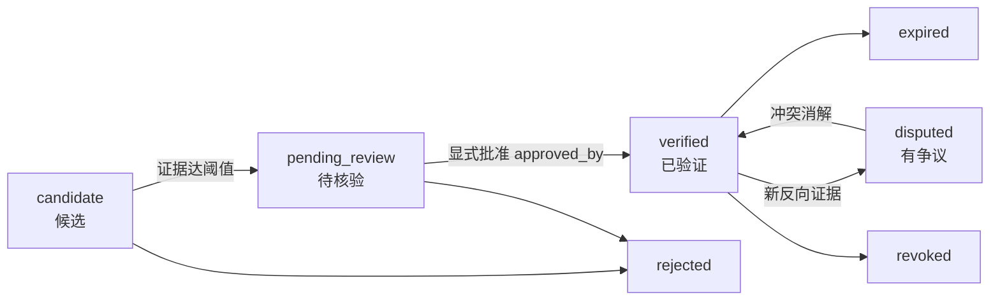

# API 契约规范（FIG API Contracts）

> 版本 **v1.1** · 2026-11-13 · 状态：**frozen**
> 冻结依据：架构评审裁决 2026-11-13（disputed 批准 / locale=C 保留 / 阈值语义修正 / I-5 落地）
> 维护者：`architect` ｜ 消费方：`frontend`、`industry-ai`、`graph-eng`、`devops`

---

## 一、总则

| 项 | 规定 |
|---|---|
| Base path | `/api/v1`（仅业务端点） |
| 探针 | `/health`、`/ready` **不带版本前缀** |
| 时间 | ISO 8601 UTC，带 `Z` |
| ID | UUIDv7 字符串，应用侧生成 |
| 金额 | 字符串十进制 |
| 分页 | 列表端点游标分页；图谱端点不分页（`truncated` 即终态） |
| 鉴权 | P1–P3 单用户；P4 起 Bearer |
| 排序 | 名称排序一律用 `name_sort_key`（数据库 `locale=C`，不能按原文排序） |

---

## 二、双层结构与阈值语义（核心契约）



**四条契约级承诺：**

1. **阈值只决定能否进入核验流程，绝不自动置为 verified。**
   `candidate → pending_review` 只需证据达阈值；`pending_review → verified` 额外需要 `approved_by`（人工或 QA），自动化 actor（`system:` / `auto:` / `pipeline:` 前缀）一律拒绝。
2. **`disputed` 只能从 `verified` 进入。** 它表示「已验证事实受到新证据挑战」，不是「还在核验」。`pending_review → disputed` 是非法迁移。
3. `candidate` / `pending_review` / `rejected` 状态的关系**永不出现在任何 `/graph/*` 响应中**；`POTENTIAL_*` 四类关系**永不进入 Neo4j**。
4. **`disputed` 关系不得作为确定事实参与投资机会传导。** 传导算法只接受 `status = verified` 的边。

---

## 三、统一响应信封

### 3.1 成功 / 失败

```json
{ "data": {}, "meta": { "request_id": "...", "generated_at": "2026-11-13T00:20:00Z" } }
```

```json
{ "error": { "code": "EVIDENCE_REQUIRED", "message": "...", "details": {}, "request_id": "..." } }
```

404 / 405 也走信封（已实现 `StarletteHTTPException` 处理器）。

### 3.2 错误码（封闭集合）

| HTTP | code | 含义 |
|---|---|---|
| 400 | `VALIDATION_ERROR` | 参数不合法 |
| 400 | `DEPTH_LIMIT_EXCEEDED` | 深度 > 5 |
| 400 | `NODE_LIMIT_EXCEEDED` | 节点数超上限 |
| 401 | `UNAUTHORIZED` | 未认证 |
| 403 | `FORBIDDEN` | 无权限 |
| 404 | `NOT_FOUND` | 资源不存在 |
| 409 | `CONFLICT` | 唯一约束冲突 |
| 409 | `STATE_TRANSITION_INVALID` | 非法迁移 / 类型不可入图 / 状态不可用于传导 |
| 422 | `EVIDENCE_REQUIRED` | 证据不足、缺 Claim、缺批准、disputed 缺反向证据 |
| 422 | `CLAIM_TYPE_NOT_PROMOTABLE` | 该 Claim 类型不可提升 |
| 429 | `RATE_LIMITED` | 限流 |
| 502 | `UPSTREAM_UNAVAILABLE` | 外部依赖不可用 |
| 503 | `DEPENDENCY_NOT_READY` | PG / Neo4j / 迁移版本未就绪 |
| 500 | `INTERNAL_ERROR` | 未分类 |

---

## 四、枚举（唯一真源 `backend/app/schemas/enums.py`）

### 4.1 关系状态（7 态，语义已区分）

| 状态 | 含义 | 是否入图 | 是否可用于传导 |
|---|---|---|---|
| `candidate` | AI 产出或人工录入，未核验 | ❌ | ❌ |
| `pending_review` | 证据达阈值，已进核验队列，等人工判断 | ❌ | ❌ |
| `verified` | 已批准的事实 | ✅ | ✅ |
| `disputed` | **已验证事实受到新证据挑战**，双方证据并存 | ✅（标注 disputed） | ❌ |
| `rejected` | 已否定（终态） | ❌ | ❌ |
| `expired` | 已过期 | ✅ | ❌ |
| `revoked` | 已撤销（终态，行不删除） | ✅ | ❌ |

### 4.2 合法迁移表（唯一真源 `validation/state_guard.py`）

| from \ to | candidate | pending_review | verified | disputed | rejected | expired | revoked |
|---|---|---|---|---|---|---|---|
| **candidate** | — | ✅ | ❌ | ❌ | ✅ | ❌ | ✅ |
| **pending_review** | ❌ | — | ✅ | **❌** | ✅ | ❌ | ✅ |
| **verified** | ❌ | ❌ | — | ✅ | ❌ | ✅ | ✅ |
| **disputed** | ❌ | ❌ | ✅ | — | ✅ | ❌ | ✅ |
| **expired** | ❌ | ✅ | ✅ | ❌ | ❌ | — | ✅ |
| **rejected** | ❌ | ❌ | ❌ | ❌ | — | ❌ | ❌ |
| **revoked** | ❌ | ❌ | ❌ | ❌ | ❌ | ❌ | — |

### 4.3 其他枚举

`ClaimType`：`fact_reported` / `inferred` / `hypothesis` / `disputed`
`EvidenceGrade`：`A` / `B` / `C` / `D`
`NewsEventType`：16 值，见 `enums.py`
`ImpactPathStatus`：`valid` / `invalidated` / `stale`
`RelationshipHistory.trigger`：`claim_promotion` / `evidence_threshold` / `manual_approval` / `new_evidence` / `rule` / `migration` / `manual`

---

## 五、证据阈值与独立性

### 5.1 阈值（v1，已生效）

| 项 | 值 |
|---|---|
| 达标条件 | **1 条 A/B 级**，或 **2 条 C 级且来自不同 `origin_key`** |
| 作用 | 只决定 `candidate → pending_review` |
| 生效版本 | `evidence.threshold_version = "v1"` |
| 可调参数 | `app_setting`：`evidence.required_grades` / `evidence.min_c_origins` / `evidence.auto_verify`（后者即使为 true 也不能绕过批准） |
| 变更审计 | `app_setting_history`（key / 旧值 / 新值 / 版本 / 原因 / 操作者 / 生效时间） |

### 5.2 独立性判定（重要修正）

**不同 `content_hash` 不代表独立来源。**

- 每条 `evidence` 必须携带 `origin_key` —— 它标识**原始报道**，不是这一份拷贝。
- 转载、引用、摘编、同文不同标题：共用同一个 `origin_key`，`syndicated_from_id` 指向首发行。
- 阈值计数按 `COUNT(DISTINCT origin_key)`，不按 `COUNT(content_hash)`。
- 视图 `v_evidence_origin` 提供按来源聚合的行数、文本数、最强等级。

### 5.3 验证的前置条件（全部满足）

1. 关系至少关联 1 条 Claim（无 Claim = 无来源 → 422）。
2. 所有关联 Claim 的 `claim_type = fact_reported`。
3. 证据达阈值（见 5.1）。
4. **显式批准**：`approved_by` 非空且不是自动化 actor。
5. 无未消解的 `contradicting` 证据（有则只能停在 `pending_review`）。

---

## 六、端点清单

### 6.1 系统（不带版本前缀）

| 方法 | 路径 | 说明 | 状态 |
|---|---|---|---|
| GET | `/health` | 存活探针 | ✅ |
| GET | `/ready` | PG + Neo4j + Alembic 版本，5s TTL 缓存 | ✅ |
| GET | `/openapi.json` | OpenAPI 3.1 | ✅ |

### 6.2 采集

| 方法 | 路径 | 说明 |
|---|---|---|
| POST | `/ingest/run` | 异步触发（202 + `run_id`），需 `Idempotency-Key` |
| GET | `/ingest/runs/{run_id}` | 运行统计（含 per-source 明细） |
| GET | `/ingest/sources` | 信源清单 + `last_fetched_at` 水位 |
| GET | `/ingest/dead-letters` | 失败条目 |
| POST | `/ingest/dead-letters/{id}/retry` | 重放 |

### 6.3 新闻

`GET /news`（游标分页）、`GET /news/{id}`

### 6.4 实体与产业

| 方法 | 路径 | 说明 |
|---|---|---|
| GET | `/industries` | 产业树（层级 + `entity_count`） |
| GET | `/entities` | `entity_type, q, industry_code, sort=name_sort_key` |
| GET | `/entities/{id}` | 详情（含 aliases、`name_sort_key`） |
| GET | `/entities/{id}/relations` | 关系（默认只返回 verified） |
| GET | `/companies`、`/companies/{stock_code}` | 公司查询 |

**排序契约**：`sort` 只接受 `name_sort_key`（默认）。响应同时返回 `canonical_name` 与 `name_sort_key`，前端不得自行按原文排序——数据库 collation 为 C，原文排序对中文是字节序。

### 6.5 证据

| 方法 | 路径 | 说明 |
|---|---|---|
| POST | `/evidence` | 写入证据。`origin_key` 必填；转载需带 `syndicated_from_id` |
| GET | `/evidence/{id}` | 单条 |
| GET | `/relationships/{id}/evidence` | 该关系全部证据（含 `relation` 区分正反） |

`Evidence` 对象：

```json
{
  "id": "0192...",
  "source_type": "announcement",
  "source_name": "巨潮资讯",
  "source_url": "https://...",
  "title": "关于签订重大合同的公告",
  "original_excerpt": "……",
  "published_at": "2026-11-10T00:00:00Z",
  "collected_at": "2026-11-12T03:00:00Z",
  "evidence_grade": "A",
  "verification_status": "unverified",
  "content_hash": "sha256:...",
  "origin_key": "origin-abc",
  "syndicated_from_id": null,
  "supersedes_id": null
}
```

**不可变性（I-5）**：`original_excerpt` / `content_hash` / `origin_key` / `source_*` / `evidence_grade` / 时间戳一经写入不可 UPDATE；任何 DELETE 被拒。修正 = 新增一行 + `supersedes_id`（须同 `origin_key`、且不早于原行）。唯一允许的 UPDATE 是 `verification_status`。

### 6.6 图谱（只读，只含已验证层）

| 方法 | 路径 | 说明 |
|---|---|---|
| GET | `/graph/subgraph` | 首屏子图，`node_limit ≤ 2000` |
| GET | `/graph/neighbors` | `direction, depth ≤ 5, relation_types, min_confidence` |
| POST | `/graph/expand` | 受限扩展 |
| GET | `/graph/path` | `from, to, max_depth ≤ 5` |

- `status` 只作用于边。
- 默认只返回 `verified`；`include_disputed=true` 才含 `disputed`（前端必须用虚线 + 「有争议」标签区分）。
- `truncated=true` 即终态，无续页游标。
- v1 无 `as_of` 参数。

### 6.7 关系生命周期（状态迁移）

| 方法 | 路径 | 从 → 到 | 前置条件 |
|---|---|---|---|
| POST | `/relationships/{id}/submit-review` | candidate → pending_review | 证据达阈值 + 有 Claim |
| POST | `/relationships/{id}/verify` | pending_review → verified | 阈值 + `approved_by` + 无反向证据 |
| POST | `/relationships/{id}/dispute` | **verified → disputed** | `contradicting_evidence_ids` 非空 |
| POST | `/relationships/{id}/reject` | candidate/pending/disputed → rejected | 终态 |
| POST | `/relationships/{id}/revoke` | 任意非终态 → revoked | 终态，行不删除 |
| GET | `/relationships` | — | `?status=candidate` 为候选层读取入口 |
| GET | `/history/relationships/{id}` | — | 每次迁移含 `trigger` / `actor` / `reason` / `evidence_ids` |

`verify` 请求体：

```json
{ "approved_by": "human:kevin", "reason": "公告核对", "evidence_ids": ["0192..."] }
```

`dispute` 请求体：

```json
{ "actor": "human:kevin", "reason": "客户否认合作", "contradicting_evidence_ids": ["0192..."] }
```

> 没有 `POST /relationships`，没有 `DELETE`。关系只能由 Claim 提升产生，只能状态迁移消亡。

### 6.8 Claim（候选层）

`POST /analyze/news/{id}`、`GET /analyze/{id}`、`GET /claims`、`POST /claims/{id}/promote`、`POST /claims/{id}/reject`

### 6.9 事件与传导

`GET /events`、`GET /events/{id}`、`POST /events/{id}/propagate`、`GET /events/{id}/impact-paths`

**传导准入**：只用 `status = verified` 的边。`disputed` / `expired` / `revoked` 一律排除，命中即返回 `STATE_TRANSITION_INVALID`（代码：`assert_usable_for_propagation`）。

### 6.10 质量中心 / 6.11 系统管理

`/quality/metrics`、`/quality/issues`、`/quality/scan`、`/quality/impact/{relationship_id}`
`/admin/agents`、`/admin/tasks`、`/admin/logs`、`/admin/settings`（读写阈值，写操作必须带 `reason`，落 `app_setting_history`）

---

## 七、幂等

| 场景 | 机制 |
|---|---|
| `POST /ingest/run` | `Idempotency-Key`，24h 内返回首次结果（`idempotency_key` 表） |
| `POST /analyze/news/{id}` | 以 `news_id` 为键 |
| 状态迁移 | 目标 == 当前 → 200 + 当前状态，不报错 |
| 重试 | 仅 `429/502/503` 与网络错误，指数退避 ≤ 3 次 |

---

## 八、本版关闭的评审项

| # | 问题 | 结论 |
|---|---|---|
| Q-02 | `POTENTIAL_*` 是否进图 | 不进图（ADR-0007） |
| Q-06 | `DISPUTED` 第 7 态 | **批准**，语义限定为「已验证后受挑战」 |
| Q-07 | `locale=C` | **保留**，排序键在应用层（ADR-0009/0010） |
| Q-08 | 证据阈值 | **保留 v1**，但阈值只决定进入核验；独立性改按 `origin_key` |
| — | I-5 证据不可变 | 触发器实现，见 6.5 |
