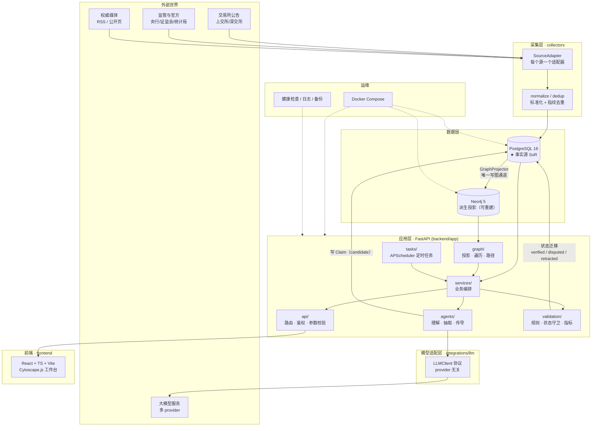
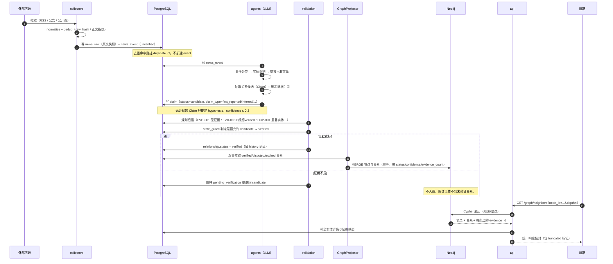
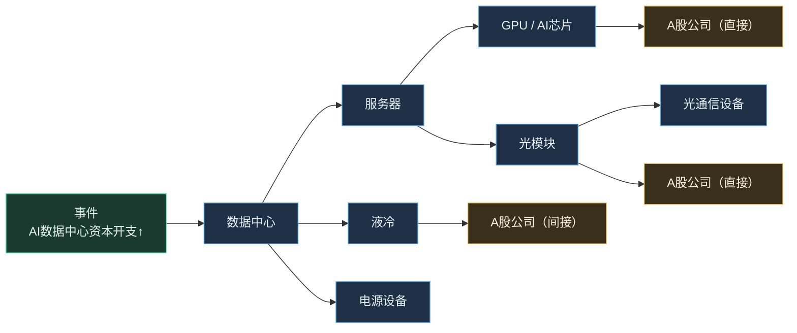
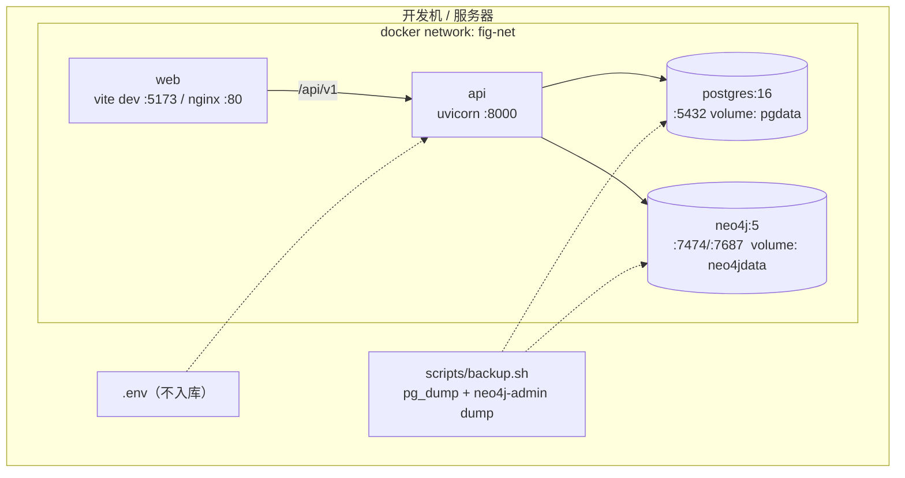

# 总体架构设计（FIG）

> 版本 v0.1 · 2026-11-12 · 状态：**待 Phase 0 评审**
> 维护者：`architect` ｜ 会签：`graph-eng`、`qa-audit`

---

## 一、架构形态：模块化单体 + 单一受控写图管道

**不做微服务。** 初期用模块化单体（Modular Monolith）：一个 FastAPI 进程，内部按职责分包，包间只经服务层接口调用。

理由：
1. 团队是 AI Agent，跨进程调试成本远高于跨包调用。
2. 图谱一致性需要事务边界——微服务会把一致性变成分布式事务问题。
3. 后续真要拆，包边界清晰就够拆；反之现在拆了也合不回来。

**唯一例外**：Neo4j 与 PostgreSQL 是独立进程（数据库），必须处理双写一致性——见第四节。

---

## 二、总体架构图



**读图要点**：注意 `PG → Neo4j` 那一条单向箭头。**没有任何其他箭头指向 Neo4j。** 这是本架构最重要的一条线。

---

## 三、核心架构决策

### ADR-0001：PostgreSQL 是唯一事实源，Neo4j 是派生投影

| | 内容 |
|---|---|
| **决策** | 所有实体、关系、证据、状态、审计历史只写 PG。Neo4j 由 `GraphProjector` 从 PG 单向投影，可随时清空重建。 |
| **理由** | ① 避免双写不一致；② 图可重建 = 可修复 = 可回滚；③ 满足「禁止多个 Agent 同时写正式图谱」；④ 关系历史与状态机在关系型库更好表达。 |
| **代价** | 图查询前需保证投影新鲜（秒级延迟可接受）；投影器成为单点，需监控。 |
| **替代方案** | 以 Neo4j 为主库（否决：历史版本、复杂约束、审计查询弱）；双主（否决：一致性不可控）。 |

### ADR-0002：Python 版本锁定 3.12

当前机器为 3.13.14。部分 C 扩展（如某些 async 驱动、科学计算轮子）在 3.13 上轮子覆盖不全，容器内统一用 3.12-slim。本地开发建议 pyenv 装 3.12。

### ADR-0003：Claim / Evidence / Verified Relationship 三层分离

```
Evidence（证据，不可变）
   ↑ 引用
Claim（主张，可被支持/反驳，状态：candidate / supported / refuted / disputed）
   ↓ 通过状态守卫 + 规则校验后才可生成
VerifiedRelationship（正式关系，进入图谱）
```

- Claim **不能** 直接变成 VerifiedRelationship——必须经过 `state_guard` 的合法性校验 + 至少一条达标证据。
- Claim 与 Relationship 是**两张表**，不是一张表的两个状态。原因：一条关系可能由多个 Claim 支撑，一个 Claim 可能拆成多条关系。
- 详见 [database-schema.md](database-schema.md) 与 [graph-schema.md](graph-schema.md)。

### ADR-0004：LLM 只能通过 `LLMClient` 协议访问

业务代码禁止 `import openai`。所有模型调用走 `integrations/llm/base.py` 定义的协议，支持 provider 切换、录制回放（测试用）、token 计量。

### ADR-0005：任务调度用 APScheduler，不引 Prefect（初期）

单进程 + 定时采集 + 定时投影 + 定时质量扫描，APScheduler 足够。任务规模上来（>50 个 DAG 依赖）再评估 Prefect。**先别为未来的规模付现在的复杂度。**

---

## 四、数据流：一条新闻的完整旅程



**关键约束（在代码里必须成立）**：

1. 未验证关系**永不出现在**任何图查询结果中。
2. 每条边必须能返回至少一个 `evidence_id`；若历史数据缺失，返回 `evidence_missing: true` 而不是编造。
3. 投影是幂等的：同一份 PG 数据投影 N 次，图状态一致。
4. 一条关系的状态变化必须写 `relationship_history`，禁止原地覆盖。

---

## 五、事件传导的扩展边界



**约束（必须落到代码与配置）**：

| 参数 | 默认 | 上限 | 可配置 |
|---|---|---|---|
| 扩展深度 | 3 | 5 | 系统设置 |
| 单次节点上限 | 300 | 2000 | 系统设置 |
| 最低证据质量 | C | — | 系统设置 |
| 低置信隔离阈值 | 0.5 | — | 系统设置 |

每条路径必须输出：起始事件、路径节点、路径关系、影响方向（正/负/不确定）、影响周期、证据数量与质量分布、置信度、关键不确定因素。
**禁止把多个模型的置信度简单累加**——评分规则统一在 `validation/scoring.py`，且同一新闻的多家转载按 1 条独立证据计。

---

## 六、部署拓扑



健康检查：`GET /health`（存活）｜`GET /ready`（PG + Neo4j + 迁移版本，任一失败 503）。
**当前状态：Docker daemon 未运行，容器拓扑尚未实测**（见 project-status.md 风险 R-01）。

---

## 七、模块依赖方向（单向，禁止反向）

```
api → services → { collectors, agents, graph, validation } → models / schemas
tasks → services
integrations/llm ← agents（只允许 agents 调用）
```

**禁止**：
- `models` / `schemas` 依赖任何业务包（它们是最底层）。
- `collectors` 依赖 `graph` 或 `agents`（采集层不认识产业关系）。
- `agents` 直接调 `graph.repository`（必须经 `services`，保证规则统一）。
- 任何包绕过 `services` 直接写 `relationship` 表。

---

## 八、技术选型与风险

| 选型 | 版本 | 风险 | 缓解 |
|---|---|---|---|
| FastAPI | ≥0.115 | 低 | — |
| SQLAlchemy | 2.0（async） | 中：async session 生命周期易错 | 统一 `core/db.py` 提供 session 依赖 |
| Alembic | ≥1.13 | 低 | Migration 只由 architect 生成 |
| PostgreSQL | 16 | 低 | — |
| Neo4j | 5.x Community | 中：Community 无集群、内存受限 | 单机够用；投影可重建降低风险 |
| Cytoscape.js | 3.x | 中：万级节点性能 | 首屏 ≤300 节点 + 聚合展开 |
| APScheduler | 3.x | 中：多进程会重复执行 | 单 worker 部署，或加 DB 锁 |
| Python 3.13（现机） | — | **高：轮子覆盖** | 锁 3.12（ADR-0002） |
| Docker daemon | 未运行 | **阻塞** | 人工启动（R-01） |

---

## 九、Phase 0 待评审问题

1. 该架构是否合理？（模块化单体 + 单一投影管道）
2. 哪些技术有兼容性/实现风险？（Python 3.13、Neo4j Community、Cytoscape 性能）
3. 哪些可并行？——见 [task-dependencies.md](task-dependencies.md) 波次划分
4. 哪些必须串行？——Schema 冻结 → Migration → 投影器 → 采集入库
5. 最容易卡壳？——实体消歧、证据达标判定、投影一致性
6. 如何降低协作冲突？——目录归属矩阵 + 契约先冻结 + 单一写图管道
7. 如何验证 AI 生成的产业关系？——Claim/Evidence/Verified 三层 + 规则引擎 + 错误注入测试
8. 如何避免错误向下游扩散？——状态守卫 + 撤销触发重算 + 下游影响清单
9. 如何保证可追溯？——evidence 不可变 + relationship_history + 每次投影留 run_id
10. 如何控制初期成本？——不拆微服务、不引 Prefect、先单产业（AI 算力）50–100 家公司
