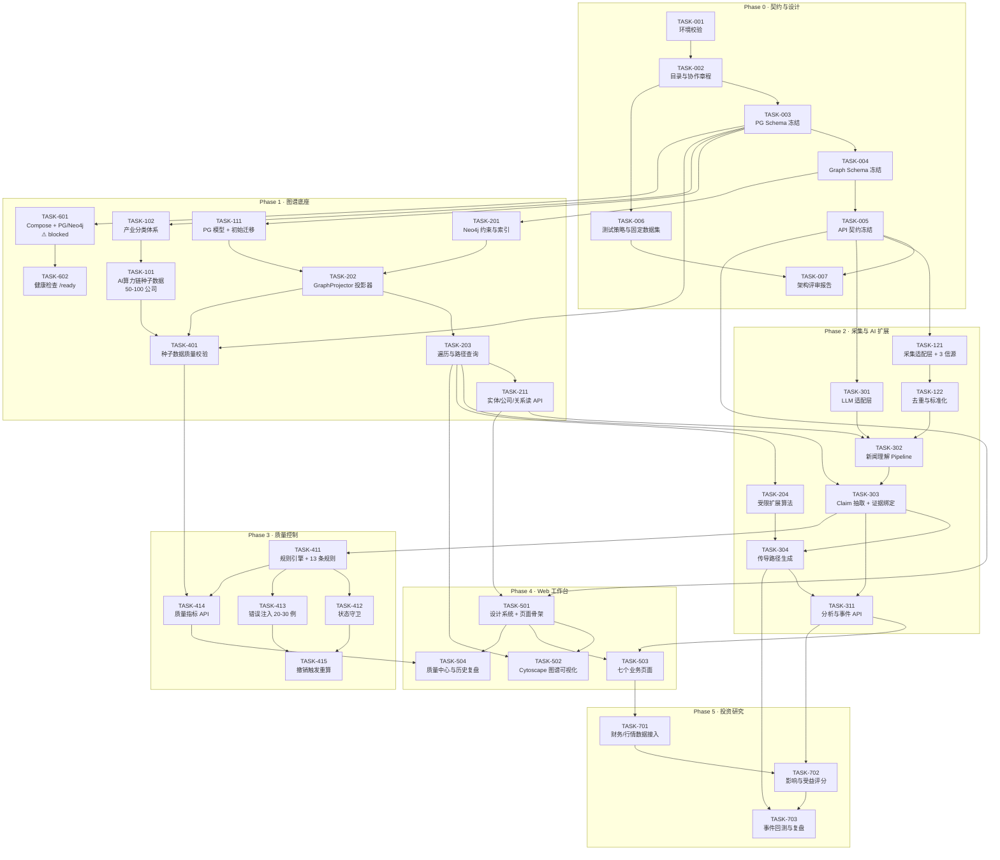

# 任务依赖图与开发任务清单

> 版本 v0.1 · 2026-11-12 · 维护者：`architect`
> **唯一任务真源是 [task-board.md](task-board.md)**；本文件负责依赖关系、并行波次与关键路径。

---

## 一、依赖原则

1. **契约先行**：任何消费方任务，其依赖的契约必须 `frozen`。
2. **单向依赖**：`P0 契约 → P1 底座 → P2 采集与推理 → P3 质量 → P4 界面 → P5 投资`，禁止跨阶段反向依赖。
3. **无环**：下图必须无环。发现环 = 设计有问题，改设计，不要绕过。
4. **并行只发生在「无数据依赖、只有契约依赖」的节点**。

---

## 二、任务依赖图



---

## 三、并行波次（实际派发顺序）

| 波次 | 可并行任务 | 门禁（进入条件） | 说明 |
|---|---|---|---|
| **W0** | TASK-001, TASK-002 | 无 | 主架构师独做，**不派子 Agent** |
| **W1** | TASK-003, TASK-006 | W0 完成 | Schema 与测试策略可并行；测试策略只依赖「要测什么」，不依赖具体表 |
| **W2** | TASK-004, TASK-005 | T003 冻结 | 图 Schema 与 API 契约可并行（都以 PG Schema 为锚） |
| **W3** | TASK-007, TASK-111, TASK-102, TASK-601* | T005 冻结 | 评审报告与实现可并行；T601 受 Docker 阻塞 |
| **W4** | TASK-201, TASK-101, TASK-121, TASK-301, TASK-501 | T004 冻结 + T003 迁移可用 | **本波是最大并行点**，5 个 Agent 同时开工 |
| **W5** | TASK-202, TASK-122, TASK-302, TASK-502, TASK-602 | W4 产出就绪 | 投影器/去重/理解/可视化骨架 |
| **W6** | TASK-203, TASK-303, TASK-503, TASK-401 | W5 完成 | 遍历/Claim 抽取/页面/数据校验 |
| **W7** | TASK-211, TASK-304, TASK-411 | W6 完成 | API 聚合、传导、规则引擎 |
| **W8** | TASK-204, TASK-311, TASK-412, TASK-413 | W7 完成 | 扩展算法、分析 API、状态守卫、错误注入 |
| **W9** | TASK-414, TASK-415, TASK-504 | W8 完成 | 质量指标、撤销重算、质量中心页面 |
| **W10** | TASK-701 → TASK-702 → TASK-703 | P4 验收 | 串行，投资结论必须最后做 |

\* TASK-601 当前 **blocked**（Docker daemon 未运行），解除后可随时插入 W3。

---

## 四、关键路径

```
TASK-003 (PG Schema)
  → TASK-111 (迁移)
  → TASK-202 (投影器)
  → TASK-203 (遍历)
  → TASK-211 (读 API)
  → TASK-501 (前端骨架)
  → TASK-503 (七页面)
  → TASK-701 (数据接入)
```

**这条链上任一任务延期，整体延期。** 其余任务都有并行余量。
**最高风险节点：TASK-202（投影器）** —— 它同时被 P1/P2/P3 依赖，且是「PG 与图一致性」的唯一保障。

---

## 五、任务清单

> 完整字段（inputs/outputs/files_scope/acceptance/test_requirements）见 [task-board.md](task-board.md)。此处只列 ID / 标题 / 负责 Agent / 依赖。

### Phase 0

| ID | 标题 | Agent | 依赖 | 状态 |
|---|---|---|---|---|
| TASK-001 | 开发环境校验与记录 | architect | — | ✅ completed |
| TASK-002 | 目录骨架与协作章程 | architect | T001 | ✅ completed |
| TASK-003 | PostgreSQL Schema 设计与冻结 | architect | T002 | 🟡 in_progress |
| TASK-004 | Neo4j 图 Schema 设计与冻结 | architect + graph-eng | T003 | ⚪ pending |
| TASK-005 | API 契约冻结 + OpenAPI 骨架 | architect | T003, T004 | ⚪ pending |
| TASK-006 | 测试策略与固定数据集设计 | qa-audit | T002 | ⚪ pending |
| TASK-007 | 架构评审报告（Phase 0 交付） | architect | T005, T006 | ⚪ pending |

### Phase 1

| ID | 标题 | Agent | 依赖 | 状态 |
|---|---|---|---|---|
| TASK-101 | AI 算力产业链种子数据（50–100 家） | data-eng | T102 | ⚪ pending |
| TASK-102 | 产业分类体系 seeds | data-eng | T003 | ⚪ pending |
| TASK-111 | PG 模型 + Alembic 初始迁移 | architect | T003 | ⚪ pending |
| TASK-201 | Neo4j 约束与索引 | graph-eng | T004 | ⚪ pending |
| TASK-202 | GraphProjector 投影器（幂等） | graph-eng | T111, T201 | ⚪ pending |
| TASK-203 | 遍历 / 路径查询 | graph-eng | T202 | ⚪ pending |
| TASK-211 | 实体 / 公司 / 关系读 API | architect | T203 | ⚪ pending |
| TASK-401 | 种子数据质量校验 | qa-audit | T101, T202 | ⚪ pending |
| TASK-601 | Compose + PG/Neo4j 编排 | devops | T003 | 🔴 **blocked（Docker daemon）** |
| TASK-602 | 健康检查 /health /ready | devops | T601 | ⚪ pending |

### Phase 2

| ID | 标题 | Agent | 依赖 | 状态 |
|---|---|---|---|---|
| TASK-121 | 采集适配层 + 3 个真实信源 | data-eng | T005 | ⚪ pending |
| TASK-122 | 去重与标准化 | data-eng | T121 | ⚪ pending |
| TASK-301 | LLM 适配层（provider 无关 + 录制回放） | industry-ai | T005 | ⚪ pending |
| TASK-302 | 新闻理解 Pipeline（分类/实体/链接） | industry-ai | T122, T301, T211 | ⚪ pending |
| TASK-303 | Claim 抽取 + 证据绑定 | industry-ai | T302 | ⚪ pending |
| TASK-304 | 传导路径生成（受深度/节点上限） | industry-ai | T303, T204 | ⚪ pending |
| TASK-204 | 受限扩展算法 | graph-eng | T203 | ⚪ pending |
| TASK-311 | 分析与事件 API | architect | T303, T304 | ⚪ pending |

### Phase 3

| ID | 标题 | Agent | 依赖 | 状态 |
|---|---|---|---|---|
| TASK-411 | 规则引擎 + 首批 13 条规则 | qa-audit | T303 | ⚪ pending |
| TASK-412 | 状态守卫 state_guard | qa-audit | T411 | ⚪ pending |
| TASK-413 | 错误注入用例集（20–30 例） | qa-audit | T411 | ⚪ pending |
| TASK-414 | 质量指标 API | qa-audit | T411, T401 | ⚪ pending |
| TASK-415 | 撤销触发下游重算 | qa-audit + graph-eng | T412, T413 | ⚪ pending |

### Phase 4

| ID | 标题 | Agent | 依赖 | 状态 |
|---|---|---|---|---|
| TASK-501 | 设计系统 + 页面骨架（Mock） | frontend | T005, T211 | ⚪ pending |
| TASK-502 | Cytoscape 图谱可视化 | frontend | T501, T203 | ⚪ pending |
| TASK-503 | 七个业务页面 | frontend | T501, T311 | ⚪ pending |
| TASK-504 | 质量中心与历史复盘页 | frontend | T501, T414 | ⚪ pending |

### Phase 5

| ID | 标题 | Agent | 依赖 | 状态 |
|---|---|---|---|---|
| TASK-701 | 财务 / 估值 / 行情数据接入 | data-eng | T503 | ⚪ pending |
| TASK-702 | 事件影响与公司受益评分 | industry-ai | T701, T311 | ⚪ pending |
| TASK-703 | 事件回测与复盘 | qa-audit | T702, T304 | ⚪ pending |

---

## 六、阻塞清单

| # | 阻塞项 | 影响任务 | 需要谁 | 状态 |
|---|---|---|---|---|
| B-01 | Docker daemon 未运行 | TASK-601、TASK-602、全部容器化验证 | **人工启动 Docker Desktop** | 🔴 open |
| B-02 | Python 3.13 vs 依赖轮子 | 容器镜像、async 驱动 | architect 定版 3.12（ADR-0002） | 🟡 待确认 |
| B-03 | 数据源许可与频控未核实 | TASK-121 | data-eng 调研后报 architect | ⚪ 未开始 |
| B-04 | 实体消歧标准未定（何为「同一公司」） | TASK-101、TASK-401、TASK-302 | architect + qa-audit 会签 | ⚪ 未开始 |
| B-05 | 「证据达标」阈值需真实数据校准 | TASK-411、TASK-412 | 需 T101 种子数据先落地 | ⚪ 未开始 |

---

## 七、任务编号规则

```
TASK-<阶段号><序号>
P0: 0xx    P1: 1xx（含 2xx 底座细分）   P2: 2xx/3xx   P3: 4xx   P4: 5xx   P5: 7xx
```

- 编号一经分配不复用。
- 任务拆分产生子任务：`TASK-202-a`、`TASK-202-b`。
- 任务作废：状态置 `cancelled` 并写明原因，**不删除记录**。
